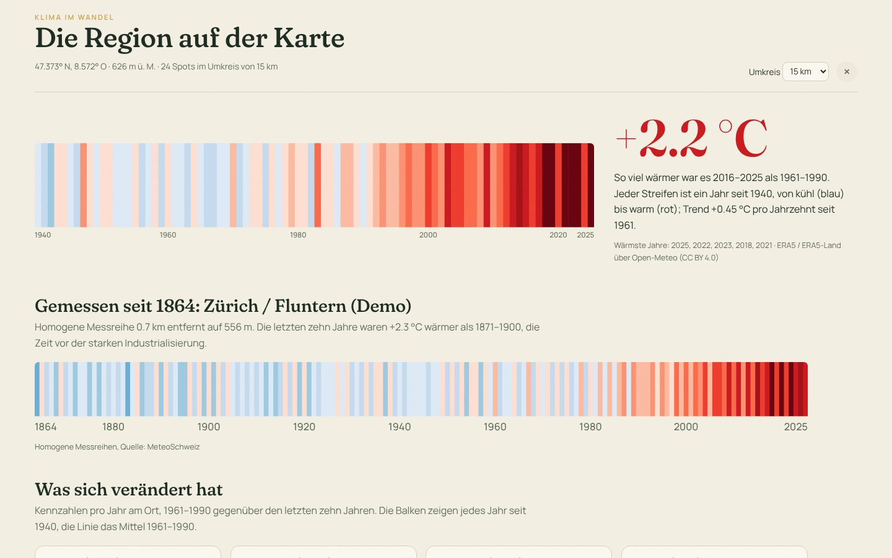
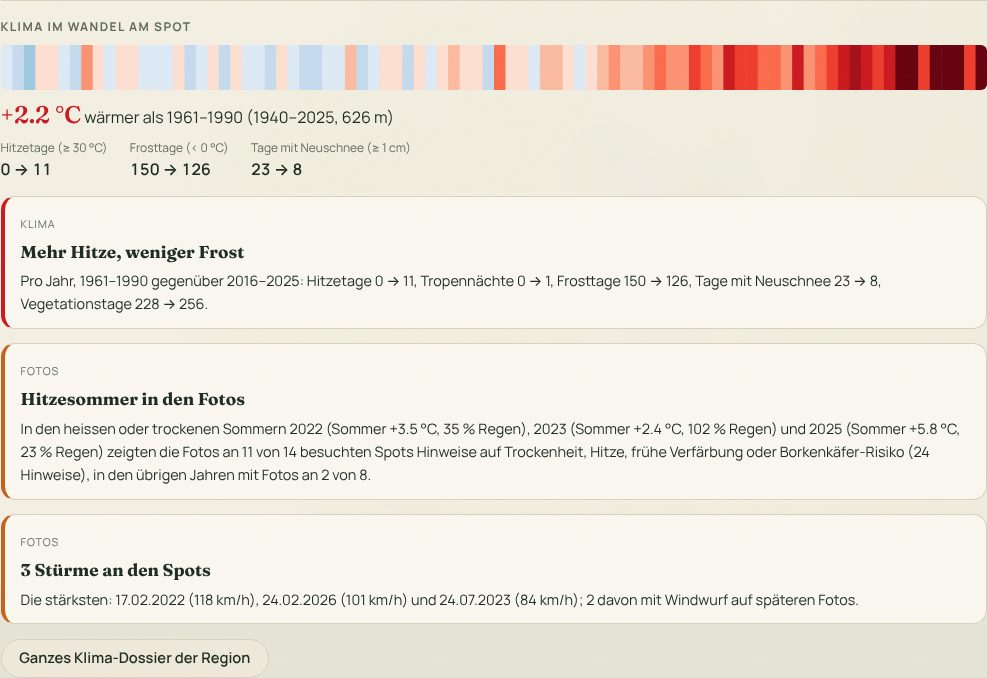
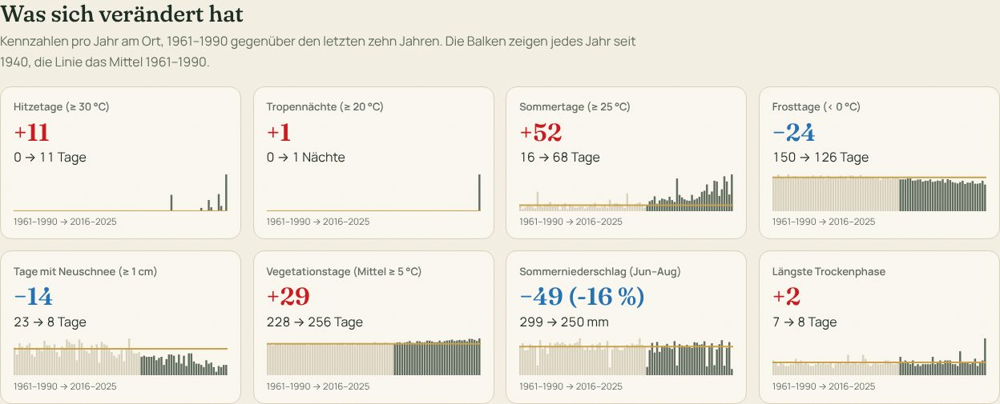
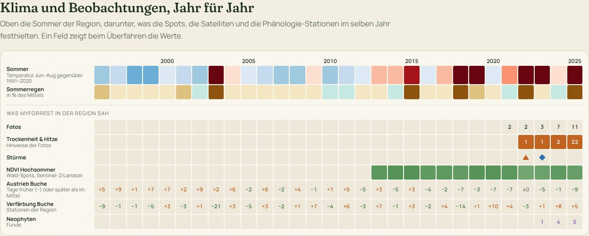
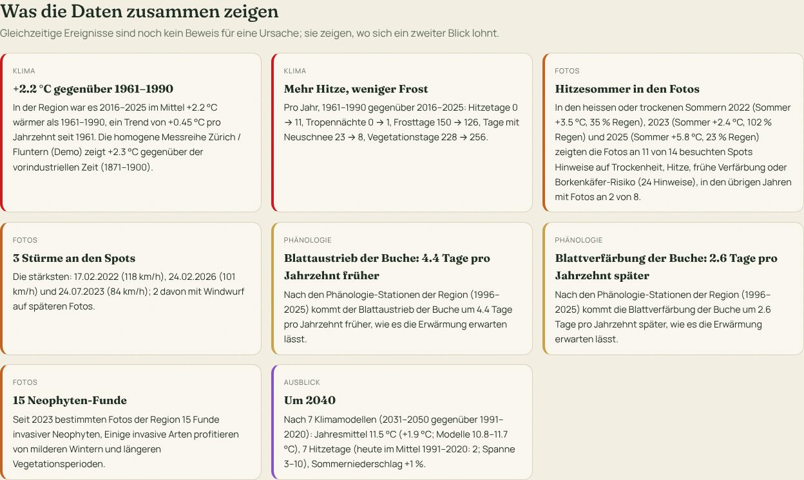
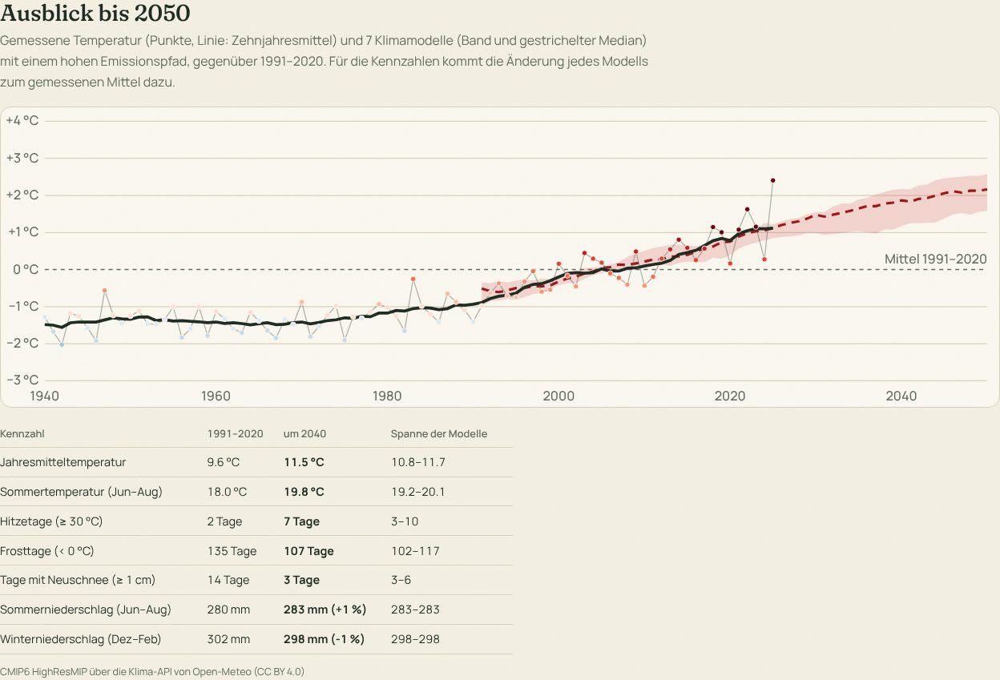

# Klima im Wandel – die Region im Kontext

Der Wald verändert sich, weil sich das Klima verändert. Die Fotos von MyForrest zeigen Windwurf, dürre Buchen,
Borkenkäfernester und schmelzendes Eis; dieses Modul zeigt, welches Klima dahintersteht, in der Region um einen
Spot oder um die Kartenmitte, und legt beides auf eine gemeinsame Zeitachse.



> **Warum lokal?** Der nächste Sachstandsbericht des Weltklimarats IPCC verzögert sich, weil sich Staaten nicht
> auf einen Zeitplan einigen; knapp 120 Forschende haben in einem offenen Brief erklärt, dass sie trotzdem
> weiterarbeiten ([SRF Wissen](https://www.srf.ch/wissen/klimawandel/weltklimarat-forschende-wehren-sich-gegen-verschleppung-von-klimabericht)).
> Globale Berichte bleiben die Grundlage. Was man vor der eigenen Haustür messen und fotografieren kann, lässt sich
> aber nicht verschleppen: offene Messreihen der MeteoSchweiz, Szenarien des Bundes und die Fotos aus dem eigenen
> Wald. MyForrest führt sie zusammen.

> Die Screenshots zeigen den Demo-Datensatz: synthetisches Wetter mit einer Erwärmung wie im Mittelland, eine
> erfundene Messreihe «Zürich / Fluntern (Demo)» und eine erfundene Phänologie-Station. Im Betrieb kommen die Werte
> aus den unten genannten Quellen.

## Auf einen Blick

| Frage | Antwort im Dossier | Quelle |
|-------|--------------------|--------|
| Wie stark hat sich die Region erwärmt? | Klimastreifen 1940 bis zum letzten vollen Jahr, Erwärmung gegenüber 1961–1990, Trend pro Jahrzehnt | ERA5 / ERA5-Land über Open-Meteo |
| Und seit der vorindustriellen Zeit? | Klimastreifen der nächsten homogenen Messreihe seit 1864, Erwärmung gegenüber 1871–1900 | Homogene Messreihen der MeteoSchweiz (NBCN) |
| Was heisst das konkret? | Hitzetage, Tropennächte, Sommertage, Frosttage, Neuschnee, Vegetationstage, Sommerregen, Trockenphasen: früher und heute | ERA5, Tageswerte |
| Was sah MyForrest in denselben Jahren? | Zeitachse mit Fotos, Hinweisen auf Trockenheit und Hitze, Stürmen, NDVI im Hochsommer, Austrieb und Verfärbung der Buche, Schneeschmelze, Eis, Neophyten | Spots, Sentinel-2/Landsat, Phänologie |
| Was folgt daraus? | Aussagen, die Klima und Beobachtungen verbinden, mit Zahlen | Synthese in `src/klima.js` |
| Wie geht es weiter? | Temperatur bis 2050 nach Klimamodellen, Kennzahlen um 2040 mit der Spanne der Modelle; auf Wunsch die Klimaszenarien CH2025 | CMIP6 HighResMIP, CH2025 |

## Das Modul in der App

**Auf der Karte** öffnet der Knopf **Klima** (bunte Streifen) das Dossier für die Kartenmitte. Oben rechts lässt
sich der Umkreis wählen (5, 15 oder 30 km): Er bestimmt, welche Spots in die Zeitachse und in die Synthese
eingehen. Das Klima selbst gilt für den Mittelpunkt und seine Höhe. Esc oder × schliesst das Dossier.

**Im Spot** zeigt der Tab **Klima** die Kurzfassung für den Ort und seine Höhe: Klimastreifen, die Erwärmung, drei
Kennzahlen und die wichtigsten Aussagen aus einem Umkreis von 5 km. *Ganzes Klima-Dossier der Region* öffnet das
Dossier um den Spot (15 km).

<p align="center"></p>

Beim ersten Öffnen für einen Ort lädt der Server die Tageswerte seit 1940 (drei Anfragen) und die Klimamodelle
(eine Anfrage pro Modell); das dauert einige Sekunden. Danach liegen die Jahreswerte in der Datenbank, und das
Dossier öffnet sofort. Orte im selben Feld von rund 10 km und in derselben Höhenstufe von 100 m teilen sich die
Werte.

## Das Dossier, Teil für Teil

### Klimastreifen und Erwärmung

Jeder Streifen ist ein Jahr, gefärbt nach der Abweichung der Jahresmitteltemperatur vom Mittel 1961–1990, in
Schritten von 0,325 °C von dunkelblau (kühl) bis dunkelrot (warm), wie die *warming stripes* von Ed Hawkins
([showyourstripes.info](https://showyourstripes.info)), die MeteoSchweiz auch für Schweizer Stationen zeigt. Daneben
steht, wie viel wärmer die letzten zehn Jahre waren als 1961–1990, der lineare Trend pro Jahrzehnt seit 1961 und
die fünf wärmsten Jahre.

Ist eine **homogene Messreihe** der MeteoSchweiz geladen, folgt der Streifen der nächsten Station seit Messbeginn
(meist 1864). Homogen heisst: Sprünge durch Stationsverlegungen und neue Instrumente sind herausgerechnet, nur so
lassen sich 160 Jahre vergleichen. Aus dieser Reihe stammt auch die Erwärmung gegenüber **1871–1900**, der
vorindustriellen Referenz der MeteoSchweiz. Die Station wird wie bei der Phänologie gewählt: 100 m
Höhenunterschied zählen wie 10 km Entfernung, höchstens 80 km.

### Was sich verändert hat



Acht Karten vergleichen das Mittel 1961–1990 mit den letzten zehn Jahren. Die kleinen Balken zeigen jedes Jahr seit
1940 (ab 1991 dunkler), die goldene Linie das Mittel 1961–1990. Kennzahlen, die am Ort praktisch nicht vorkommen
(etwa Tropennächte in den Bergen), fallen weg.

| Kennzahl | Definition |
|----------|------------|
| Hitzetage | Tageshöchstwert ≥ 30 °C |
| Sommertage | Tageshöchstwert ≥ 25 °C |
| Tropennächte | Tagestiefstwert ≥ 20 °C |
| Frosttage | Tagestiefstwert < 0 °C |
| Eistage | Tageshöchstwert < 0 °C |
| Vegetationstage | Tagesmittel ≥ 5 °C (grobes Mass für die Länge der Vegetationszeit) |
| Tage mit Neuschnee | Schneefall ≥ 1 cm |
| Längste Trockenphase | Längste Folge von Tagen mit weniger als 1 mm Niederschlag |
| Sommer, Winter | Juni–August bzw. Dezember–Februar (der Dezember zählt zum Winter des Folgejahrs) |

Es sind dieselben Schwellen, die MeteoSchweiz für ihre Klimaindikatoren verwendet; berechnet werden sie hier aber
aus ERA5 am Ort, nicht aus Stationsmessungen.

### Klima und Beobachtungen, Jahr für Jahr



Das Herzstück: pro Jahr eine Spalte (die letzten 30 Jahre, früher, wenn es ältere Beobachtungen gibt), pro Quelle
eine Zeile.

- **Sommer** und **Sommerregen**: Temperatur Juni–August in der Farbskala der Streifen und Niederschlag in % des
  Mittels 1991–2020, von braun (trocken) bis blaugrün (nass).
- **Fotos**: Anzahl Fotos der Spots im Umkreis.
- **Trockenheit & Hitze**: Hinweise des [Wetter-Kontexts](funktionen.md#wetter-kontext-und-auffälligkeiten)
  (Trockenheit, Wärme, frühe Laubverfärbung, Nadelverfärbung, Borkenkäfer-Risiko), pro Spot und Jahr einmal gezählt.
- **Stürme**: Sturmereignisse an den Spots (◆), mit Windwurf auf späteren Fotos (▲)
  ([Sturmereignisse](funktionen.md#sturmereignisse)).
- **NDVI Hochsommer**: Mittel aus Juli und August über die Wald-Spots (Sentinel-2, vor 2017 Landsat); je dunkler,
  desto grüner.
- **Austrieb** und **Verfärbung der Buche**: an den bis zu drei nächsten Phänologie-Stationen (MeteoSchweiz, DWD),
  als Tage früher (−, grün) oder später (+) als im Mittel der gezeigten Jahre.
- **Schneeschmelze** (Gebirge-Spots), **Eis im Spätsommer** (Gletscher-Spots) und **Neophyten**-Funde.

Jedes Feld nennt beim Überfahren die Werte. So fallen Muster auf, die keine Quelle allein zeigt: Im Demo-Datensatz
etwa decken sich die Hitzesommer 2022 und 2025 mit den Hinweisen der Fotos, und die Buchen verfärben sich in den
Hitzesommern zwei Wochen zu früh.

### Was die Daten zusammen zeigen



Aus allen Reihen entstehen Aussagen mit Zahlen. Sie sind bewusst als **Gleichzeitigkeit** formuliert, nicht als
Beweis: Ein heisser Sommer und ein Borkenkäfernest im selben Jahr können zusammenhängen, müssen aber nicht.

| Aussage | Wann sie erscheint |
|---------|--------------------|
| Erwärmung gegenüber 1961–1990 (und 1871–1900) | Immer, sobald die Klimareihe geladen ist |
| Mehr Hitze, weniger Frost | Hitzetage, Tropennächte, Frosttage, Neuschnee und Vegetationstage, früher gegenüber heute |
| Hitzesommer in den Fotos | Mindestens zwei Jahre mit Fotos und Hinweise in Sommern, die mindestens 1 °C wärmer waren als 1991–2020 oder höchstens 75 % des Regens hatten; verglichen werden besuchte Spots mit Hinweisen in diesen Sommern und in den übrigen Jahren |
| Weniger Grün in Hitzesommern | Der NDVI im Hochsommer liegt in solchen Sommern mindestens 0,02 unter den anderen Jahren |
| Stürme an den Spots | Sturmereignisse im Wetter-Kontext der Fotos, die stärksten drei, wie viele mit Windwurf |
| Austrieb / Verfärbung der Buche | Mindestens zehn Jahre an den Stationen und ein Trend von mindestens einem Tag pro Jahrzehnt |
| Schnee schmilzt früher | Mindestens vier Jahre Schneeschmelze an Gebirge-Spots, die zweite Hälfte mindestens einen halben Monat früher |
| Weniger Eis im Spätsommer | Mindestens drei Jahre und 10 Prozentpunkte weniger Schnee und Eis an Gletscher-Spots |
| Neophyten-Funde | Funde in mindestens zwei Jahren |
| Um 2040 | Klimamodelle verfügbar: Jahresmittel, Hitzetage und Sommerregen mit Spanne |

### Ausblick bis 2050



Das Diagramm zeigt die gemessene Jahrestemperatur (Punkte in der Farbe der Streifen, Linie: gleitendes
Zehnjahresmittel) und sieben Klimamodelle (Band: Spanne, gestrichelt: Median), alles als Abweichung vom Mittel
1991–2020. Die Modelle stammen aus **CMIP6 HighResMIP** (Auflösung rund 10–50 km), die Open-Meteo über seine
Klima-API anbietet; nach 2014 folgen sie einem hohen Emissionspfad (etwa SSP5-8.5). Bis 2050 unterscheiden sich die
Emissionspfade noch wenig, danach stark; darum endet der Ausblick hier.

Für die Tabelle rechnet der Server die **Delta-Methode**: Für jedes Modell die Änderung einer Kennzahl zwischen
1991–2020 und 2031–2050 (Temperaturen und Tage absolut, Niederschlag und Schnee relativ), aufgeschlagen auf das
gemessene Mittel 1991–2020 am Ort. So stören die Fehler der Modelle im absoluten Niveau nicht. Gezeigt werden der
Median und die Spanne der Modelle.

Sind die **Klimaszenarien CH2025** geladen (siehe [Einrichten](#einrichten)), folgt eine Tabelle für den nächsten
Ort mit Szenarien: die Änderung gegenüber 1991–2020 bei 1,5, 2 und 3 °C globaler Erwärmung. CH2025 sind die
offiziellen Szenarien der Schweiz (MeteoSchweiz und ETH Zürich im Rahmen des NCCS, veröffentlicht im November
2025) und für Aussagen über die Schweiz die bessere Wahl als die globalen Modelle; sie stehen aber nicht über eine
Abfrage pro Ort bereit.

## Welche Daten es gibt

Die Recherche für dieses Modul, nach Themen. *Eingebaut* heisst: MyForrest lädt oder liest die Daten heute;
*Import*: per Datei bzw. Admin-Abfrage; *geplant*: siehe [Roadmap](roadmap.md#phase-5-klima-im-wandel).

### Klima: Messungen und Reanalysen

| Quelle | Herausgeber | Inhalt | Zeitraum, Auflösung | Zugang, Lizenz | In MyForrest |
|--------|-------------|--------|---------------------|----------------|--------------|
| [Homogene Messreihen (NBCN)](https://opendatadocs.meteoswiss.ch/c-climate-data/c1-climate-stations_homogeneous) | MeteoSchweiz | Temperatur, Niederschlag u. a., homogenisiert, Tag/Monat/Jahr | seit 1864, 29 Klima- und 46 Niederschlagsstationen | OGD über STAC (`ch.meteoschweiz.ogd-nbcn`), CSV pro Station; «Quelle: MeteoSchweiz» | Import (Jahreswerte) |
| [Messnetz SwissMetNet](https://opendatadocs.meteoswiss.ch/) | MeteoSchweiz | Messwerte aller automatischen Stationen | 10 Minuten bis Jahr | OGD über STAC, CSV | geplant |
| Raumanalysen (Gitter) | MeteoSchweiz | Tagestemperatur und -niederschlag als Gitter | seit 1961, 1–2 km | OGD | geplant |
| [Klimanormwerte 1991–2020](https://www.meteoschweiz.admin.ch/klima/klima-der-schweiz/klimanormwerte.html) | MeteoSchweiz | Mittelwerte und Indikatoren pro Station | 1991–2020 | Tabellen, Karten auf map.geo.admin.ch | – (Normale aus ERA5) |
| [ERA5 / ERA5-Land](https://open-meteo.com/en/docs/historical-weather-api) | Copernicus / ECMWF | Reanalyse: Temperatur, Niederschlag, Schnee, Wind … | seit 1940, rund 9–30 km, stündlich | über Open-Meteo, ohne Schlüssel, CC BY 4.0 | **eingebaut** |
| [E-OBS](https://surfobs.climate.copernicus.eu/dataaccess/access_eobs.php) | Copernicus / ECA&D | Gitter aus Stationsdaten Europas | seit 1950, 0,1° | NetCDF | geplant (Gegenprobe zu ERA5) |
| [Klimabulletins und Klimaindikatoren](https://www.meteoschweiz.admin.ch/klima/klimawandel.html) | MeteoSchweiz | Einordnung von Monaten, Jahren, Indikatoren (Nullgradgrenze, Vegetationsperiode …) | laufend | Berichte | Text, Verweis |

### Szenarien und Modelle

| Quelle | Herausgeber | Inhalt | Zeitraum, Auflösung | Zugang | In MyForrest |
|--------|-------------|--------|---------------------|--------|--------------|
| [Klimaszenarien CH2025](https://www.nccs.admin.ch/) | MeteoSchweiz, ETH Zürich, NCCS | Szenarien für 1,5, 2 und 3 °C globale Erwärmung; Tagesreihen pro Station (DAILY-LOCAL) und auf 1 km (DAILY-GRIDDED), Indikatoren im Webatlas | Referenz 1991–2020, je 30 Jahre pro Erwärmungsstufe | OGD über STAC, Webatlas CH2025 | Import (Änderungen pro Ort als CSV) |
| CH2018 | MeteoSchweiz, ETH, NCCS | Vorgänger nach Emissionspfaden (RCP2.6, 4.5, 8.5) | bis 2099 | NCCS | Import möglich (gleiches CSV) |
| [Hydro-CH2018](https://www.bafu.admin.ch/de/daten-hydro-ch2018) | BAFU | Abfluss, Wassertemperatur, Schnee in der Zukunft | bis 2099 | Daten pro Einzugsgebiet | geplant |
| [Klima-API (CMIP6 HighResMIP)](https://open-meteo.com/en/docs/climate-api) | Open-Meteo aus CMIP6 | Tageswerte von sieben Modellen | 1950–2050, rund 10–50 km | ohne Schlüssel, CC BY 4.0 | **eingebaut** |
| [EURO-CORDEX, CMIP6](https://cds.climate.copernicus.eu/) | Copernicus Climate Data Store | Regionale und globale Modelle nach Szenarien | bis 2100 | Konto beim CDS, NetCDF | geplant |
| [IPCC Interactive Atlas](https://interactive-atlas.ipcc.ch/) | IPCC | Regionale Auswertungen der Berichte | bis 2100 | Web | Verweis |

### Gletscher, Schnee, Permafrost

| Quelle | Herausgeber | Inhalt | In MyForrest |
|--------|-------------|--------|--------------|
| [GLAMOS](https://www.glamos.ch/) | ETH, Universitäten, MeteoSchweiz | Längenänderung, Massenbilanz, Inventare (1850, 1973, 2016) | **eingebaut** (Länge, Umrisse) |
| [SLF](https://www.slf.ch/) | WSL-Institut für Schnee- und Lawinenforschung | Schneehöhen, lange Messreihen, IMIS-Stationen | geplant (Schneetage, Schneedecke) |
| [PERMOS](https://www.permos.ch/) | Schweizer Permafrostmessnetz | Bodentemperatur, Blockgletscher | geplant (Gebirge-Spots) |
| Sentinel-2 | Copernicus | Schnee und Eis an den Spots | **eingebaut** |

### Wald und Vegetation

| Quelle | Herausgeber | Inhalt | In MyForrest |
|--------|-------------|--------|--------------|
| [Phänologie](https://opendatadocs.meteoswiss.ch/) | MeteoSchweiz, DWD | Austrieb, Blüte, Verfärbung seit 1951 | **eingebaut** (Buche) |
| [Waldschutz Schweiz](https://www.waldschutz.ch/) | WSL | Borkenkäfer, Krankheiten, Meldungen | geplant (Käfer-Generationen aus Wärmesummen) |
| [Landesforstinventar LFI](https://www.lfi.ch/) | WSL, BAFU | Zustand und Entwicklung des Schweizer Waldes | Verweis |
| [Trockenheit](https://www.drought.ch/) | WSL, BAFU | Trockenheitsindizes, Bodenfeuchte, Früherkennung | geplant |
| [Tree-App](https://www.tree-app.ch/) | BAFU, WSL, Kantone | Baumartenempfehlung pro Standort bei mässigem und starkem Klimawandel | geplant (Verweis pro Spot; eine offene Schnittstelle gibt es nicht) |
| Sentinel-2, Landsat | Copernicus, USGS/NASA | NDVI, NDMI an den Spots | **eingebaut** |

### Wasser, Arten, Stadtklima

| Quelle | Herausgeber | Inhalt | In MyForrest |
|--------|-------------|--------|--------------|
| [Hydrologische Daten](https://www.hydrodaten.admin.ch/) | BAFU | Abfluss, Wassertemperatur (Rhein seit Jahrzehnten) | geplant |
| [Biodiversitätsmonitoring BDM](https://www.biodiversitymonitoring.ch/) | BAFU | Verschiebung der Arten in die Höhe | Verweis |
| [Info Flora](https://www.infoflora.ch/) | Info Flora | Neophyten, Rote Liste | **eingebaut** (Export, Schutzlisten) |
| Kantonale Klimakarten | Kantone (z. B. Zürich) | Hitzebelastung, Kaltluftströme im Siedlungsgebiet | geplant (Abgleich mit kühlen Abschnitten) |

## Was sich zusammenführen lässt

Die eigentliche Stärke liegt in der Verbindung: Klimadaten sagen, *was* sich verändert; die Fotos zeigen, *wo* und
*wie* es im Wald ankommt. Diese Verbindungen sind heute eingebaut oder als Nächstes geplant:

| Klimasignal | MyForrest-Daten | Was daraus wird | Stand |
|-------------|-----------------|-----------------|-------|
| Heisse, trockene Sommer (ERA5, NBCN) | Hinweise der Fotos, NDVI/NDMI im Hochsommer | Trockenstress sichtbar machen: welche Spots in welchen Sommern litten | **eingebaut** |
| Stürme (Böen) | Windwurf auf Fotos | Welcher Sturm welchen Windwurf brachte | **eingebaut** |
| Frühlingswärme | Austrieb der Buche, Spätfrost-Hinweise | Früherer Austrieb, Frost danach | **eingebaut** (Austrieb, Spätfrost) |
| Wintertemperatur, Neuschnee | Schneeschmelze an Gebirge-Spots | Früher aper, Verbuschung der Alpweiden | **eingebaut** (Schneeschmelze) |
| Sommertemperatur | Eis im Spätsommer, GLAMOS | Gletscherschwund pro Hitzesommer | **eingebaut** (Eisanteil) |
| Mildere Winter, längere Vegetationszeit | Neophyten-Funde, Ausbreitung | Ausbreitungstempo gegenüber den Wintern | teilweise (Funde pro Jahr) |
| Wärmesumme (Grad-Tage) | Borkenkäfer-Fotos | Anzahl Käfergenerationen pro Jahr (wie das Modell PHENIPS) | geplant |
| Szenarien (CH2025) | Baumarten am Spot | Welche Arten am Spot künftig unter Druck kommen; Verweis auf die Tree-App | geplant |
| Klima-Analoga | Spots | «Wo ist es heute so warm wie hier um 2050?» – Spots dort als Blick in die Zukunft | geplant |
| Hitzetage, Tropennächte | Kühle Abschnitte aus Touren | Wie viel kühler der Wald an Hitzetagen ist | geplant |

## Wie gerechnet wird

1. **Tageswerte holen**: Open-Meteo-Archiv, 1940 bis Ende des letzten vollen Jahres, Temperatur (Mittel, Höchst-,
   Tiefstwert), Niederschlag und Schneefall, auf die Höhe des Ortes umgerechnet (`elevation`). Drei Anfragen zu je
   30 Jahren.
2. **Jahreswerte**: [`src/klima.js`](https://github.com/michifrey/myforrest/blob/main/src/klima.js) rechnet pro
   vollständigem Jahr (mindestens 360 Tage) die Kennzahlen. Nur sie werden gespeichert, nicht die Tageswerte.
3. **Bezüge**: Streifen und Veränderung gegenüber 1961–1990, Ausblick gegenüber 1991–2020, homogene Reihen
   zusätzlich gegenüber 1871–1900. «Heute» sind die letzten zehn vollen Jahre.
4. **Trend**: lineare Regression der Jahreswerte seit 1961, pro Jahrzehnt.
5. **Modelle**: dieselben Kennzahlen pro Modell für 1991–2050, Delta-Methode wie oben.
6. **Region**: alle Spots im Umkreis, die die Person sehen darf (geschützte Funde nur für PRO-Mitglieder, wie
   überall); Hinweise zählen pro Spot und Jahr einmal.
7. **Synthese**: Regeln mit festen Schwellen (siehe Tabelle oben), alle in `synthesize()`.

## Grenzen

- **ERA5 ist ein Modell auf einem Gitter.** Es glättet: In Städten unterschätzt es Hitzetage und Tropennächte, in
  Senken und Tälern den Frost, im Gebirge den Schnee. Die Umrechnung auf die Höhe hilft bei der Temperatur, nicht
  beim Niederschlag. Für die Erwärmung und ihre Richtung ist es gut, für exakte Zahlen am Ort sind Messreihen besser.
- **Die Klimamodelle bilden Jahre nicht nach.** Ein Modelljahr 2040 ist keine Prognose für 2040, nur ein mögliches
  Jahr im Klima um 2040. Aussagekräftig sind Mittel und Spanne über 20 Jahre.
- **Ein Emissionspfad.** Die Klima-API kennt nur den hohen Pfad; bis 2050 ist der Unterschied zu mittleren Pfaden
  klein, danach nicht. Für die Schweiz gelten die Szenarien CH2025.
- **Gleichzeitig ist nicht ursächlich.** Die Synthese zählt, was zusammenfällt. Ob ein Hitzesommer einen Schaden
  verursacht hat, entscheidet der Blick auf den Ort, die Baumarten und die Fotos.
- **Wenige Spots, wenige Jahre.** Mit zwei, drei Jahren Fotos sind Vergleiche zwischen Hitzesommern und anderen
  Jahren noch Zufall; sie werden mit jedem Jahr belastbarer.

## Einrichten

Ohne Einrichtung zeigt das Dossier das Klima aus ERA5, die Klimamodelle und die Beobachtungen. Zwei Quellen
lädt eine Administratorin oder ein Administrator dazu:

**Homogene Messreihen der MeteoSchweiz.** `POST /api/klima/sync` lädt über die STAC-API von `data.geo.admin.ch`
die Stationsbeschreibung und die Jahreswerte aller Stationen (braucht Zugang zu `data.geo.admin.ch`). Ohne
Netz lassen sich die Dateien einzeln importieren, zuerst die Stationen:

```bash
curl --data-binary @ogd-nbcn_meta_stations.csv 'localhost:3000/api/klima/import?format=nbcn&kind=stations'
curl --data-binary @ogd-nbcn_sma_y.csv          'localhost:3000/api/klima/import?format=nbcn'
```

Gelesen wird die homogenisierte Jahresmitteltemperatur (`ths200y0`, sonst `tre200y0`) und der Jahresniederschlag
(`rhs150y0`, sonst `rre150y0`); die Spalten werden am Namen erkannt. Andere Reihen gehen als einfaches CSV:
`station;name;lat;lon;elevation;year;temp;precip` mit `format=stations`.

**Klimaszenarien CH2025.** Die Änderungen pro Ort, etwa aus dem Webatlas CH2025, als CSV mit den Spalten
`place;lat;lon;elevation;indicator;level;value;low;high`:

```text
place;lat;lon;elevation;indicator;level;value;low;high
Zürich / Fluntern;47.378;8.566;556;tmean;GWL2.0;…;…;…
Zürich / Fluntern;47.378;8.566;556;hotDays;GWL3.0;…;…;…
```

`indicator` ist eine der Kennzahlen (`tmean`, `hotDays`, `summerDays`, `tropicalNights`, `frostDays`, `iceDays`,
`growingDays`, `snowDays`, `snowfall`, `precip`, `dryRun`, `summerT`, `summerP`, `winterT`, `winterP`), `level`
die Erwärmungsstufe (`GWL1.5`, `GWL2.0`, `GWL3.0`, auch `1.5`, `2`, `3`), `value` die Änderung gegenüber
1991–2020 (°C, Tage, beim Niederschlag und Schnee in %), `low` und `high` die Spanne. Import:

```bash
curl --data-binary @ch2025.csv 'localhost:3000/api/klima/import?format=ch2025'
```

**Klimamodelle.** `KLIMA_MODELS` wählt die Modelle der Klima-API (kommagetrennt), leer schaltet den Ausblick ab;
siehe [Installation](installation.md#umgebungsvariablen). Die Routen stehen in der [REST-API](api.md).

## Quellen

Die Daten gehören ihren Herausgebern; MyForrest nennt sie im Dossier bei jedem Teil. ERA5 und die Klimamodelle
kommen über [Open-Meteo](https://open-meteo.com/) (CC BY 4.0, enthält modifizierte Copernicus-Daten), die Messreihen
von der [MeteoSchweiz](https://www.meteoschweiz.admin.ch/) («Quelle: MeteoSchweiz»), die Szenarien vom
[National Centre for Climate Services NCCS](https://www.nccs.admin.ch/).
