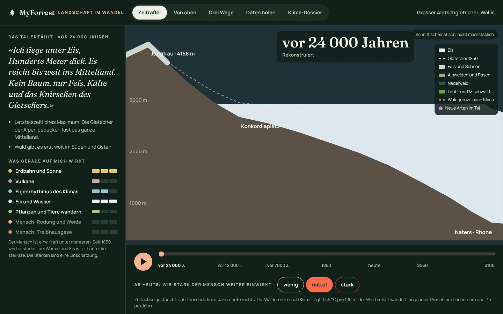
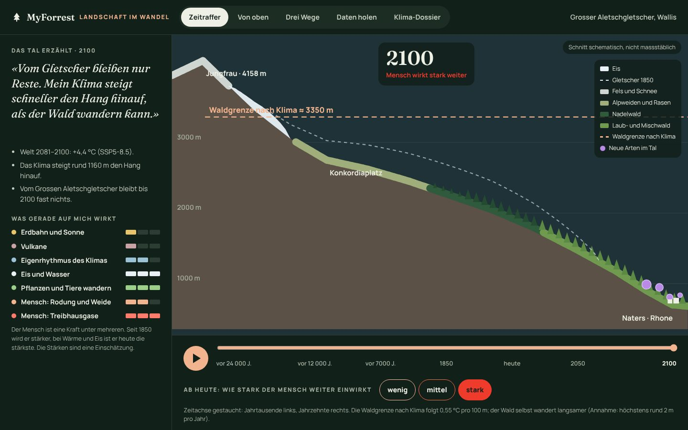
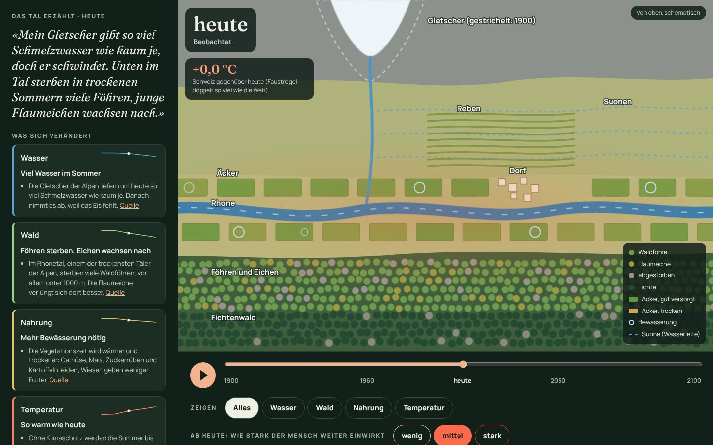
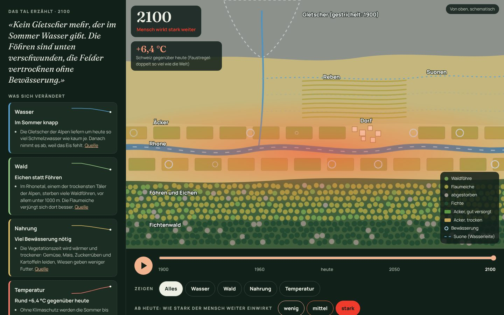
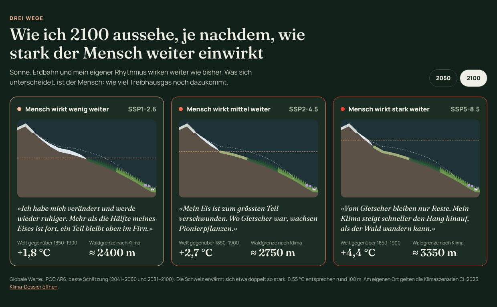

# Landschaft im Wandel – aus Sicht der Natur

MyForrest hat zwei Perspektiven auf dieselbe Landschaft:

- **Wald im Wandel, mit unseren Augen.** Menschen schauen hin, gemeinsam und von unten nach oben: Fotos von Läufen,
  Wanderungen und Touren, am selben Ort wiederholt. Das ist die Karte mit den Spots, der Hauptteil der App.
- **Landschaft im Wandel, aus Sicht der Natur.** Die Landschaft erzählt selbst, wie sie sich über Jahrtausende
  verändert hat und weiter verändert. Der Mensch ist darin eine Kraft unter mehreren, neben Erdbahn und Sonne,
  Vulkanen, dem Eigenrhythmus des Klimas, Eis und Wasser und wandernden Pflanzen und Tieren.

Die zweite Perspektive ist eine eigene Seite, `/landschaft.html`. Die Startseite stellt beide nebeneinander, und
die Navigation führt mit *Landschaft im Wandel* direkt dorthin.

> Die Seite zeigt den Grossen Aletschgletscher als Beispiel. Der Schnitt durch das Tal ist schematisch und nicht
> massstäblich; die Eisstände und die Stärke der Wirkkräfte sind aus den Quellen abgeleitete Einschätzungen, keine
> Messwerte. Was gemessen oder in der Literatur belegt ist, steht in den Aussagen unter der Stimme des Tals, mit
> Quellen am Ende der Seite.

## Zeitraffer

**Schnitt statt Karte.** Eine Karte ist der Blick des Menschen von oben. Der Zeitraffer zeigt das Tal von der Seite,
vom Gipfel der Jungfrau über den Konkordiaplatz bis zur Rhone bei Naters. So ist zu sehen, was die Landschaft selbst
ausmacht: wie das Eis das Tal füllt und wieder freigibt und wie die Höhenstufen den Hang hinauf- und hinabwandern
(Fels und Schnee, Alpweiden und Rasen, Nadelwald, Laub- und Mischwald). Eine gestrichelte Linie zeigt den Gletscher
von 1850, eine zweite die Waldgrenze, wie sie das Klima erlaubt.

**Das Tal erzählt.** Zu jedem Zeitpunkt spricht die Landschaft in der Ich-Form, etwa «Ich liege unter Eis, Hunderte
Meter dick» oder «Ich werde wärmer, schneller als seit mindestens 2000 Jahren». Darunter stehen die Aussagen mit
Quellen, die dahinterstehen.

**Was auf das Tal wirkt.** Sieben Wirkkräfte, jede mit einer Stärke von *kaum* bis *stark*: Erdbahn und Sonne,
Vulkane, Eigenrhythmus des Klimas, Eis und Wasser, Pflanzen und Tiere wandern, Mensch: Rodung und Weide, Mensch:
Treibhausgase. Beim Abspielen ist zu sehen, wie die Erdbahn die Eiszeiten bestimmt, wie der Mensch mit Rodung und
Weide früh wirkt und wie die Treibhausgase erst ab 1850 dazukommen und heute bei Wärme und Eis die stärkste Kraft
sind. Die Stärken sind eine Einschätzung.

  
  

**Sieben Zeitpunkte.** Die Zeitachse ist gestaucht, damit Jahrtausende und Jahrzehnte nebeneinander Platz haben;
dazwischen wird überblendet. Der Knopf ▶ spielt alles ab, ein Klick auf einen Zeitpunkt springt dorthin.

| Zeitpunkt | Was das Tal erlebt | Quellen |
|-----------|--------------------|---------|
| vor 24 000 Jahren | Letzteiszeitliches Maximum: Die Gletscher der Alpen bedecken fast das ganze Mittelland, nur die Gipfel ragen heraus. Kein Wald. | swisstopo, Karte des LGM 1:500 000 |
| vor 12 000 Jahren | Jüngere Dryas: ein letzter Kälterückfall, die Gletscher stossen nochmals vor (Egesen-Stadium). Föhren und Birken wandern in die Täler ein. | Ivy-Ochs et al. 2009 |
| vor 7000 Jahren | Wärmste Zeit seit der Eiszeit: Gletscher zeitweise kleiner als heute, Waldgrenze rund 120 bis 180 m höher. Erste Bauern roden. | Joerin et al. 2006; Tinner und Theurillat 2003 |
| 1850 | Ende der Kleinen Eiszeit: Der Grosse Aletschgletscher ist nahe seinem Höchststand. Die Waldgrenze liegt tief, auch wegen Rodung für Weide und Holz. | GLAMOS; Tinner und Theurillat 2003 |
| heute | Die Welt ist rund 1,1 °C wärmer als 1850–1900, die Schweiz etwa doppelt so viel. Der Grosse Aletschgletscher ist seit 1870 über 3 km kürzer geworden. | IPCC AR6; MeteoSchweiz; GLAMOS |
| 2050 | je nach Weg, siehe unten | IPCC AR6; CH2025 |
| 2100 | je nach Weg, siehe unten | IPCC AR6; Jouvet und Huss 2019; CH2025 |

**Ab heute: wie stark der Mensch weiter einwirkt.** Für die Zukunft gibt es drei Wege, *wenig*, *mittel* und
*stark*, nach den Emissionspfaden des IPCC (SSP1-2.6, SSP2-4.5, SSP5-8.5). Sonne, Erdbahn und der Eigenrhythmus
wirken weiter wie bisher; was sich unterscheidet, ist der Mensch.

**Klima und Wald.** Die Waldgrenze nach Klima folgt derselben Faustregel wie das Klima-Dossier: Die Schweiz erwärmt
sich etwa doppelt so stark wie die Welt, und 0,55 °C entsprechen rund 100 m Höhe (siehe
[Klima im Wandel](klimawandel.md#drei-szenarien-für-die-region)). Der Wald selbst wandert langsamer; die Seite nimmt
höchstens rund 2 m pro Jahr an. So ist zu sehen, wie zwischen der Waldgrenze nach Klima und dem Wald eine Lücke
entsteht, wenn die Erwärmung schnell geht.

## Von oben

Die zweite Ansicht zeigt das Rhonetal unterhalb des Aletschgletschers aus der Vogelperspektive, von 1900 bis 2100.
Oben liegt der Gletscher, von dem ein Bach zur Rhone hinunterfliesst. Am sonnigen Hang führen die **Suonen**, die
alten Wasserleiten des Wallis, Wasser zu den Reben. Im Talboden liegen Äcker und das Dorf. Am Schattenhang stehen
unten Waldföhren und Flaumeichen, oben Fichten. Alles ist animiert: Das Wasser fliesst in Rhone, Bach und Suonen, die
Bewässerung pulsiert und über dem Talboden flimmert die Hitze.

Vier Themen verändern sich gemeinsam; *Zeigen* hebt eines hervor und blendet die anderen ab:

| Thema | Was die Animation zeigt | Was die Quellen sagen |
|-------|-------------------------|-----------------------|
| **Wasser** | Der Gletscher schrumpft (gestrichelt sein Stand um 1900), Rhone und Bach werden im Sommer schmaler und langsamer, die Suonen fallen eine nach der anderen trocken. | Die Gletscher der Alpen liefern um heute so viel Schmelzwasser wie kaum je, danach weniger (Huss und Hock 2018). Im Winter fliesst mehr, im Sommer und Herbst weniger ab, übers Jahr rund 10 % weniger (BAFU, Hydro-CH2018). Die Suonen führen mit dem Gletscherschwund weniger Wasser (SRF). |
| **Wald** | Unten am Schattenhang sterben Föhren ab (grau), Flaumeichen (olivgrün) wachsen nach. | Im Rhonetal sterben viele Waldföhren, vor allem unter 1000 m; die Flaumeiche verjüngt sich dort besser (Rigling et al. 2013). Am meisten setzt den Föhren der trockene Boden zu (WSL, Pfynwald). |
| **Nahrung** | Äcker und Reben werden von grün zu ocker, es braucht immer mehr Bewässerung. | Wärmere und trockenere Vegetationszeit: Gemüse, Mais, Zuckerrüben und Kartoffeln leiden, Wiesen geben weniger Futter (Agroscope). Reben und Wiesen im Wallis hängen an den Suonen. |
| **Temperatur** | Die Hitze über dem Talboden nimmt zu; die Anzeige nennt die Erwärmung der Schweiz gegenüber heute. | Ohne Klimaschutz werden die Sommer bis Mitte Jahrhundert 2,5 bis 4,5 °C wärmer, die heissesten Tage 2 bis 5,5 °C; mit konsequentem Klimaschutz liesse sich etwa die Hälfte vermeiden (CH2018). |

Links erzählt das Tal wieder in der Ich-Form. Darunter steht pro Thema der Zustand («Im Sommer knapp», «Föhren
sterben, Eichen wachsen nach») mit einer kleinen Kurve über die fünf Zeitpunkte und den Aussagen mit Quellen. Ab heute
gelten dieselben drei Wege wie im Zeitraffer. Die Erwärmung gegenüber heute folgt der Faustregel des Klima-Dossiers
(doppelt so viel wie die Welt). Die Zeichnung ist ein Schema: Die Grössen von Gletscher, Wasser, Wald und Äckern sind
Einschätzungen aus den Quellen, keine gemessenen Werte.

## Drei Wege

Derselbe Schnitt dreimal nebeneinander, für 2050 oder 2100, jedes Mal mit der Stimme des Tals, der globalen Erwärmung
und der Waldgrenze nach Klima. Ein Klick öffnet den Weg im Zeitraffer.

| Weg | Welt 2041–2060 | Welt 2081–2100 | Waldgrenze nach Klima 2100 | Grosser Aletschgletscher bis 2100 |
|-----|----------------|----------------|----------------------------|-----------------------------------|
| Mensch wirkt wenig weiter (SSP1-2.6) | +1,7 °C | +1,8 °C | rund 220 m höher als heute | verliert rund 60 % seines heutigen Eises |
| Mensch wirkt mittel weiter (SSP2-4.5) | +2,0 °C | +2,7 °C | rund 550 m höher | verliert den grössten Teil |
| Mensch wirkt stark weiter (SSP5-8.5) | +2,4 °C | +4,4 °C | rund 1160 m höher | es bleibt fast nichts |

Globale Werte: IPCC AR6, Zusammenfassung für die Politik, Tabelle SPM.1 (beste Schätzung). Aletschgletscher: Jouvet und
Huss (2019), gerechnet mit den Szenarien CH2018 (RCP2.6 und RCP8.5); der mittlere Weg liegt dazwischen. Für den eigenen
Ort gelten die Klimaszenarien CH2025 im [Klima-Dossier](klimawandel.md).

## Daten holen

Die offenen Daten von MyForrest an einem Ort, ohne Konto: drei Angebote je nach Publikum (*Gemeinde und Forst*,
*Schule*, *GIS und Entwicklung*), eine Tabelle mit allen Collections als GeoParquet (WGS84 und LV95), GeoJSON und
OGC API, das GeoPackage, die PMTiles und der STAC-Katalog mit einem Beispiel für DuckDB. Was die Formate können, steht
unter [Offene Geodaten](funktionen.md#offene-geodaten-für-gis-und-geoportale).

## Für Schulen

Die Seite braucht kein Konto und funktioniert auf dem Handy und offline (sie gehört zur App-Shell des Service
Workers). Die Stimme des Tals in der Ich-Form macht die Zeiträume greifbar; die Aussagen darunter und die Quellen
am Ende der Seite zeigen, worauf sie sich stützen.

## Technik

- `public/landschaft-model.js`: das Modell, im Browser und in Node gleich (Tests in `test/landschaft.test.js`):
  die sieben Zeitpunkte mit Stimme, Aussagen, Quellen, Eisstand, Waldgrenze und Wirkkräften, die drei Wege, das
  Überblenden zwischen zwei Zeitpunkten und die Geometrie des Schnitts.
- `public/landschaft.js` zeichnet den Schnitt als SVG, die Ansichten *Zeitraffer*, *Drei Wege* und *Daten holen*
  (Adressen `#zeitraffer`, `#wege`, `#daten`) und die Quellen; `public/landschaft.css` gestaltet die Seite.
- `public/landschaft-oben.js` zeichnet die Ansicht *Von oben* (`#oben`); ihre fünf Zeitpunkte und Themen stehen im
  Modell (`obenStops`, `oben`, `THEMES`).
- Mit `prefers-reduced-motion` springt der Zeitraffer in grösseren Schritten statt flüssig, und Wasser, Bewässerung
  und Hitze bewegen sich nicht.

## Quellen

- swisstopo: [Die Schweiz während des letzteiszeitlichen Maximums (LGM) 1:500 000](https://opendata.swiss/de/dataset/die-schweiz-wahrend-des-letzteiszeitlichen-maximums-lgm-1-500000) (Schlüchter 2009)
- Ivy-Ochs, S. et al. (2009): [Latest Pleistocene and Holocene glacier variations in the European Alps](https://doi.org/10.1016/j.quascirev.2009.03.009). Quaternary Science Reviews 28
- Joerin, U. E., Stocker, T. F., Schlüchter, C. (2006): [Multicentury glacier fluctuations in the Swiss Alps during the Holocene](https://doi.org/10.1191/0959683606hl964rp). The Holocene 16
- Tinner, W., Theurillat, J.-P. (2003): [Uppermost limit, extent, and fluctuations of the timberline and treeline ecocline in the Swiss Central Alps during the past 11,500 years](https://doi.org/10.1657/1523-0430(2003)035[0158:ULEAFO]2.0.CO;2). Arctic, Antarctic, and Alpine Research 35
- [GLAMOS – Glacier Monitoring Switzerland](https://www.glamos.ch): Längenänderung des Grossen Aletschgletschers
- IPCC (2021): [AR6 WGI, Summary for Policymakers](https://www.ipcc.ch/report/ar6/wg1/), Tabelle SPM.1
- MeteoSchweiz: [Klimawandel Schweiz](https://www.meteoschweiz.admin.ch/klima/klimawandel.html)
- Jouvet, G., Huss, M. (2019): [Future retreat of Great Aletsch Glacier](https://folia.unifr.ch/unifr/documents/308133). Journal of Glaciology 65
- [Klimaszenarien CH2025](https://www.nccs.admin.ch/) (MeteoSchweiz, ETH Zürich, NCCS)
- NCCS: [Klimaszenarien CH2018, Kernaussagen](https://www.nccs.admin.ch/nccs/de/home/klimawandel-und-auswirkungen/schweizer-klimaszenarien/kernaussagen.html)
- BAFU: [Abflüsse im Wandel](https://www.bafu.admin.ch/de/abfluesse-im-wandel) (Hydro-CH2018)
- Huss, M., Hock, R. (2018): [Global-scale hydrological response to future glacier mass loss](https://folia.unifr.ch/unifr/documents/306551). Nature Climate Change 8
- Rigling, A. et al. (2013): [Driving factors of a vegetation shift from Scots pine to pubescent oak in dry Alpine forests](https://air.unimi.it/handle/2434/564256). Global Change Biology 19
- WSL: [Die Forschungsplattform Pfynwald](https://wsl.ch/de/ueber-die-wsl/versuchsanlagen-und-labors/flaechen-im-wald/pfynwald.html)
- SRF: [Klimawandel und Landwirtschaft – mehr Schädlinge, höhere Temperaturen, weniger Wasser](https://www.srf.ch/news/schweiz/klimawandel-und-landwirtschaft-mehr-schaedlinge-hoehere-temperaturen-weniger-wasser) (mit Agroscope)
- SRF: [Suonen im Wallis](https://www.srf.ch/news/schweiz/suonen-im-wallis-baeuerin-bewaessert-tag-und-nacht-ihre-wiesen-und-zwar-von-hand)
