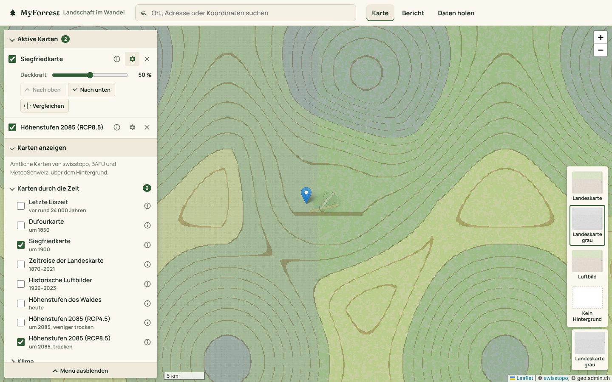
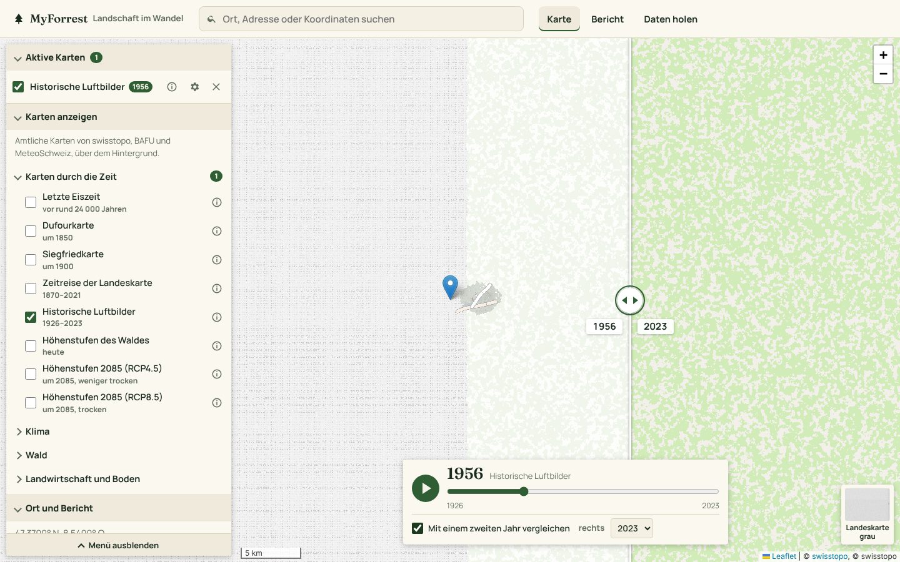
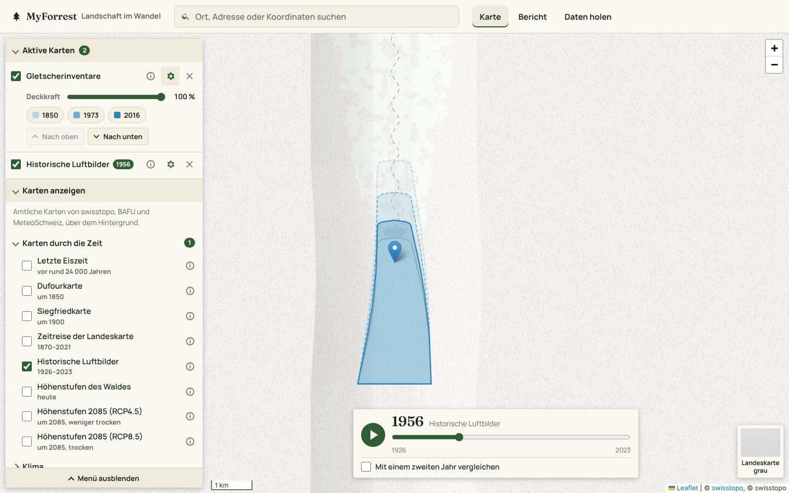
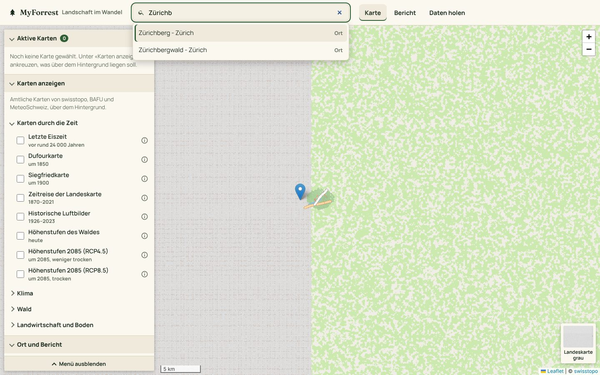
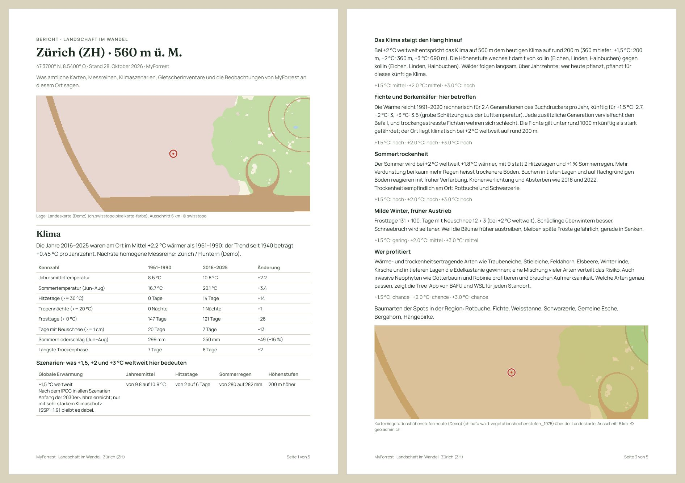
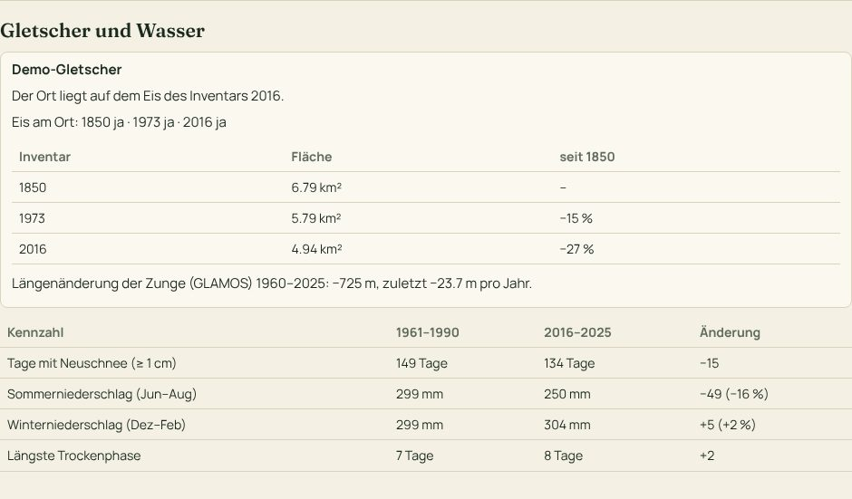

# Landschaft im Wandel – aus Sicht der Natur

MyForrest hat zwei Perspektiven auf dieselbe Landschaft:

- **Wald im Wandel, mit unseren Augen.** Menschen schauen hin, gemeinsam und von unten nach oben: Fotos von Läufen,
  Wanderungen und Touren, am selben Ort wiederholt. Das ist die Karte mit den Spots, der Hauptteil der App.
- **Landschaft im Wandel, aus Sicht der Natur.** Was mit der Landschaft selbst geschieht, über Jahrtausende und
  Jahrzehnte, aus amtlichen Karten, Messreihen und Szenarien. Der Mensch ist darin eine Kraft unter mehreren.

Die zweite Perspektive ist eine eigene Seite, `/landschaft.html`, mit drei Teilen: **Karte**, **Bericht** und
**Daten holen**. Die Startseite stellt beide Perspektiven nebeneinander, die Navigation führt mit
*Landschaft im Wandel* direkt dorthin.

> Die Screenshots zeigen den Demo-Datensatz: Statt der Karten von swisstopo und BAFU zeichnet der Demo-Server
> Platzhalter im selben Format (die Zeitreise vor 1990 in Sepia, Luftbilder vor 1990 schwarz-weiss). Im Betrieb kommen die Karten von geo.admin.ch.

## Karte

Die Karte ist aufgebaut wie [map.geo.admin.ch](https://map.geo.admin.ch/):

- Das Suchfeld steht in der Kopfzeile.
- Die Karte füllt die Seite.
- Links liegt das Menü über der Karte, mit *Menü ausblenden* lässt es sich zuklappen. Es hat drei Teile:
  - **Aktive Karten**: was gerade über dem Hintergrund liegt, die oberste Karte zuoberst.
  - **Karten anzeigen**: der Katalog, in Ordnern wie der Themenkatalog von geo.admin.ch.
  - **Ort und Bericht**.
- Unten rechts wählt man den Hintergrund, unten in der Mitte erscheint bei Karten mit Jahren die Zeitleiste.

**Karten anzeigen.** Ein Häkchen im Katalog legt eine Karte über die anderen, ein zweites Häkchen nimmt sie wieder weg.
Es lassen sich beliebig viele Karten kombinieren, etwa die Siegfriedkarte halb durchsichtig über den Höhenstufen 2085.
Die Ordner:

- *Karten durch die Zeit*
- die vier Themen des Berichts: *Klima*, *Gletscher und Wasser*, *Wald* sowie *Landwirtschaft und Boden*

Eine Zahl am Ordner zeigt, wie viele seiner Karten aktiv sind. ⓘ öffnet oben rechts die Info zur Karte mit Erklärung,
Legende und einem Link auf dieselbe Ebene in map.geo.admin.ch.

**Aktive Karten.** Jede Karte hat eine eigene Zeile:

- Das Häkchen blendet die Karte aus und wieder ein; sie bleibt dabei in der Liste.
- ⓘ zeigt die Info zur Karte.
- ✕ entfernt die Karte.
- Das Zahnrad öffnet die Einstellungen:
  - **Deckkraft**, in Prozent.
  - **Jahr**, bei der Zeitreise und den Luftbildern.
  - **Nach oben / Nach unten** ändert die Reihenfolge.
  - **Vergleichen**: Eine Linie teilt die Karte, links liegt alles ohne diese Karte, rechts mit ihr. Die Linie lässt
    sich mit Maus, Finger oder Pfeiltasten verschieben.

**Hintergrund.** Unten rechts zeigt ein Bild den aktuellen Hintergrund. Ein Klick darauf öffnet die Auswahl, wie bei
map.geo.admin.ch:

- *Landeskarte* (farbig)
- *Landeskarte grau*, der Standard, weil sich darauf alte Karten und Themen am besten lesen lassen
- *Luftbild* (SWISSIMAGE)
- *Kein Hintergrund*

Diese Karten stehen im Katalog:

| Zeit | Karte | Quelle (Ebene von geo.admin.ch) |
|------|-------|---------------------------------|
| vor rund 24 000 Jahren | Grösste Ausdehnung der Gletscher in der letzten Eiszeit | swisstopo, `ch.swisstopo.geologie-eiszeit-lgm-raster` |
| um 1850 | Dufourkarte (1845–1865), am Ende der Kleinen Eiszeit | swisstopo, `ch.swisstopo.hiks-dufour` |
| um 1900 | Siegfriedkarte (1870–1949) | swisstopo, `ch.swisstopo.hiks-siegfried` |
| Jahr für Jahr | Zeitreise der Landeskarte: die Karte, wie sie im gewählten Jahr galt | swisstopo, `ch.swisstopo.zeitreihen` (WMTS mit Zeit) |
| Flug für Flug | Historische Luftbilder (SWISSIMAGE Zeitreise, seit 1926) | swisstopo, `ch.swisstopo.swissimage-product` (WMTS mit Zeit) |
| heute | Höhenstufen des Waldes | BAFU, `ch.bafu.wald-vegetationshoehenstufen_1975` |
| um 2085, weniger trocken | Höhenstufen 2070–2099 bei mittleren Emissionen (RCP4.5) | BAFU, `ch.bafu.wald-vegetationshoehenstufen_2085_weniger_trocken` |
| um 2085, trocken | Höhenstufen 2070–2099 bei hohen Emissionen (RCP8.5) | BAFU, `ch.bafu.wald-vegetationshoehenstufen_2085_trocken` |

Dazu kommen die Ordner der vier Themen:

- *Klima*: Klimanormwerte der MeteoSchweiz, Klimaszenarien.
- *Gletscher und Wasser*: Gletscher, Abfluss, Niedrigwasser, Trockenheit, dazu die Gletscherinventare dieses Servers.
- *Wald*: Höhenstufen heute und 2085, Waldmischungsgrad und Vegetationshöhe aus dem Landesforstinventar.
- *Landwirtschaft und Boden*: Arealstatistik, Fruchtfolgeflächen, landwirtschaftliche Zonen.

Der Server sucht alle Ebenen nach Namen in der Ebenenliste von geo.admin.ch. Er liest sie einmal am Tag (WMS), wie das
Panel *Ebenen* der Karte. Es erscheint, was geo.admin.ch anbietet; fehlt eine Ebene, fehlt nur ihr Eintrag.

**Zeitleiste.** Liegt eine Karte mit Jahren oben, erscheint unten auf der Karte die Zeitleiste:

- Mit dem Regler wählt man das Jahr.
- ▶ spielt die Jahre ab, eines alle 1,2 Sekunden, damit die Kacheln nachkommen.
- Liegen beide Karten mit Jahren oben, gilt die Zeitleiste für die obere; das Jahr der anderen steht in deren
  Einstellungen.

Welche Jahre es gibt, liest der Server einmal am Tag aus den WMTS-Capabilities von geo.admin.ch
(`ZEITREISE_WMTS_URL`).

- **Zeitreise der Landeskarte:** die Landeskarten von swisstopo seit dem 19. Jahrhundert, wie sie im gewählten Jahr
  galten. Vor 1964 decken sie die Schweiz nicht überall ab.
- **Historische Luftbilder:** die Orthofotos von swisstopo (SWISSIMAGE Zeitreise) aus den Befliegungen seit 1926. Der
  Regler springt von Flugjahr zu Flugjahr. Die Schweiz wurde in Flugblöcken beflogen, nicht jedes Jahr überall: Jede
  Kachel zeigt den Flug, der den grössten Teil liefert, an den Rändern der Blöcke mischen sich die Jahre.

**Zwei Jahre nebeneinander.** In der Zeitleiste legt *Mit einem zweiten Jahr vergleichen* ein zweites Jahr derselben
Karte daneben, zu Beginn das neueste:

- Eine Linie teilt die Karte, links liegt das Jahr der Zeitleiste, rechts das Vergleichsjahr.
- Das Vergleichsjahr wählt man neben dem Häkchen.
- Beide Jahre stehen auf der Karte und im Link (`…&vergleich=2023`).

**Gletscher.** Diesen Eintrag gibt es nur, wenn auf dem Server Gletscherinventare hinterlegt sind
(`GLETSCHER_GEOJSON`, z. B. GLAMOS SGI 1850, 1973, 2010 und 2016). Dann steht im Ordner *Gletscher und Wasser* der
Eintrag *Gletscherinventare*:

- Er zeigt die Umrisse der Inventare, ein Blauton pro Inventar: die alten hell und gestrichelt, das neuste kräftig.
- In den Einstellungen zeigt ein Jahr dieses Inventar allein.
- Die Umrisse erscheinen ab Zoomstufe 9.

Über dem Luftbild von 1956 sieht man, wo das Eis damals lag und wie weit es seither zurückging.

**Ort.** Das Suchfeld in der Kopfzeile findet über den Suchdienst von geo.admin.ch (über den Server, `ORTSSUCHE_URL`):

- Gemeinden, Bezirke, Kantone und Postleitzahlen,
- Orts- und Flurnamen,
- Adressen.

Pfeiltasten und Enter wählen einen Treffer. Koordinaten findet es auch ohne den Dienst, in den Formaten von
map.geo.admin.ch:

| Format | Beispiel |
|--------|----------|
| WGS84 als Dezimalgrad | `46.6, 8.4` |
| WGS84 mit Minuten und Sekunden | `47°22′40″N 8°32′25″E` |
| LV95 | `2'600'000 1'200'000` |
| LV03 | `600'000 200'000` |
| MGRS | `32T MT 65298 47262` |

Ein Klick in die Karte wählt ebenfalls einen Ort. *Bericht für diesen Ort* öffnet den Bericht, mit dem Namen des Orts
als Titel.

**Teilen und map.geo.admin.ch.** Die Adresse hält die ganze Ansicht fest:

- `lat`, `lon` und `ort` für den Ort,
- `layers` für die aktiven Karten, in der Schreibweise von map.geo.admin.ch, die unterste zuerst, mit Jahr, `f` für
  ausgeblendet und Deckkraft: `#karte?lat=…&lon=…&layers=ch.bafu.wald-vegetationshoehenstufen_2085_trocken;ch.swisstopo.hiks-siegfried,,0.5`,
- `bg` für den Hintergrund,
- `vergleich` für das Vergleichsjahr.

*Link kopieren* legt diese Adresse in die Zwischenablage. Ältere Links mit `ansicht=…&jahr=…` öffnen weiterhin die
passende Karte.

*In map.geo.admin.ch öffnen* zeigt dieselben Karten dort, mit Jahr, Sichtbarkeit, Deckkraft, Hintergrund und dem
gewählten Ort unter dem Fadenkreuz; die Gletscherinventare dieses Servers kennt map.geo.admin.ch nicht. Umgekehrt
öffnet `landschaft.html?layers=ch.swisstopo.zeitreihen@year=1950` die passenden Karten hier, auch mit `center`, `z`
und `bgLayer` wie bei map.geo.admin.ch.

## Bericht

Der Bericht fasst zusammen, was die Quellen an einem Ort sagen, mit Lage auf der Landeskarte, Höhe und Datum.
*Drucken* gibt ihn aus dem Browser aus, ohne Navigation, schwarz auf weiss.

**PDF-Bericht.** Für Gemeinden und Forstdienste macht der Server denselben Bericht als PDF (A4, festes Layout,
Manrope und Fraunces wie die App): Kopf mit Ortsname, Höhe und Datum, ein Kartenausschnitt der Lage auf der
Landeskarte (6 km), dann die Abschnitte wie auf der Seite, jedes Thema mit einem Kartenausschnitt seiner ersten
Ebene über der Landeskarte (Klima 30 km, Gletscher und Wasser 8 km, Wald und Boden 5 km), am Ende Quellen, Link
zur Seite und Seitenzahlen. Die Kartenausschnitte holt der Server als WMS von geo.admin.ch (LV95); fehlt eine Karte,
fehlt nur ihr Bild. Adresse: `/api/landschaft/bericht.pdf?lat=…&lon=…&ort=…`.

| Abschnitt | Inhalt | Quellen |
|-----------|--------|---------|
| **Klima** | Erwärmung der letzten zehn Jahre gegenüber 1961–1990 und Trend seit 1940, Kennzahlen früher und heute (Jahres- und Sommertemperatur, Hitzetage, Tropennächte, Frosttage, Neuschnee, Sommerregen, Trockenphasen), die Szenarien +1,5, +2 und +3 °C weltweit mit Jahresmittel, Hitzetagen, Sommerregen und Höhenverschiebung, die Klimanormwerte am Ort | [Klima-Dossier](klimawandel.md): ERA5, homogene Messreihen der MeteoSchweiz, CH2025, IPCC AR6; Karten der MeteoSchweiz |
| **Gletscher und Wasser** | Gletscher in der Nähe aus den Inventaren (Eis am Ort pro Inventarjahr, Fläche des Gletschers pro Inventar und Abnahme seit dem ersten, Abstand zum heutigen Eis), Längenänderung der Zunge (GLAMOS), Neuschnee, Sommer- und Winterregen, Trockenphasen, Angaben der Wasserkarten | Gletscherinventare und GLAMOS (wenn auf dem Server hinterlegt), ERA5, geo.admin.ch |
| **Wald** | Höhenstufe heute und um 2085 in beiden Szenarien, Waldmischungsgrad und Vegetationshöhe, was die Szenarien für den Wald heissen (Höhenstufen, Fichte und Borkenkäfer, Trockenheit, Winter, wer profitiert), Baumarten der Spots | BAFU (Höhenstufen, Landesforstinventar), Klima-Dossier |
| **Landwirtschaft und Boden** | Bodennutzung (Arealstatistik) und weitere Bodenkarten, Vegetationstage, Sommerregen, Trockenphasen und Hitzetage früher und heute | BFS, BLW, ERA5 |
| **Was MyForrest sah** | Fotos und Spots im Umkreis von 5 km, Zeitraum, Befunde (Borkenkäfer, Sturm, Trockenschaden …) und Neophyten | Fotos und Funde von MyForrest (ohne ausgeblendete und geschützte) |
| **Quellen** | Alle verwendeten Datensätze und Kartenebenen mit Kennung | |

Die Fläche zählt alle Umrisse eines Inventars mit derselben SGI-Kennung, ohne Kennung mit demselben Namen (ohne
Felsinseln). Die Karten fragt der Server über den Identify-Dienst von geo.admin.ch an der Stelle ab, alle Themen gleichzeitig;
Kennungen ohne Aussage (ID, Geometrie) lässt er weg. Steht in einem Thema nichts, sagt der Bericht das.

## Daten holen

Die offenen Daten von MyForrest an einem Ort, ohne Konto: drei Angebote je nach Publikum (*Gemeinde und Forst*,
*Schule*, *GIS und Entwicklung*), eine Tabelle mit allen Collections als GeoParquet (WGS84 und LV95), GeoJSON und
OGC API, das GeoPackage, die PMTiles und der STAC-Katalog mit einem Beispiel für DuckDB. Was die Formate können, steht
unter [Offene Geodaten](funktionen.md#offene-geodaten-für-gis-und-geoportale).

## Technik

- `src/routes/landschaft.js`: `GET /api/landschaft/karten` (Karten durch die Zeit und Ebenen pro Thema, aus der
  Ebenenliste von geo.admin.ch; die Jahre der Zeitreise und der Luftbilder aus den WMTS-Capabilities, die Jahre der Gletscherinventare) `GET /api/landschaft/bericht.pdf?lat=&lon=&ort=` (der Bericht als PDF mit PDFKit, `src/landschaft-pdf.js`, Kartenausschnitte als WMS), `GET /api/landschaft/suche?q=` (Ortssuche über den SearchServer von geo.admin.ch, Koordinaten direkt) und `GET /api/landschaft/bericht?lat=&lon=` (Identify pro Thema, Gletscher aus den
  Inventaren mit GLAMOS, Fotos, Befunde und Neophyten im Umkreis). Die Ebenenliste und der Identify-Dienst kommen aus
  `src/routes/layers.js` (Panel *Ebenen*).
- `public/landschaft.html`, `landschaft.js`, `landschaft.css`: Leaflet mit den Kacheln von swisstopo und den WMS von
  geo.admin.ch; der Klima-Teil des Berichts kommt aus dem Klima-Dossier (`/api/klima`).
- Tests in `test/landschaft.test.js`, mit nachgebauter Ebenenliste und Identify-Antwort.

## Quellen

- swisstopo: [Die Schweiz während des letzteiszeitlichen Maximums (LGM) 1:500 000](https://opendata.swiss/de/dataset/die-schweiz-wahrend-des-letzteiszeitlichen-maximums-lgm-1-500000)
- swisstopo: [SWISSIMAGE Zeitreise](https://www.swisstopo.admin.ch/de/orthobilder-swissimage-10-cm) (historische Orthofotos seit 1926)
- swisstopo: [Dufourkarte](https://www.swisstopo.admin.ch/) und [Siegfriedkarte](https://www.swisstopo.admin.ch/en/siegfried-map), Landeskarte
- BAFU: [Vegetationshöhenstufen 2085 (trocken und weniger trocken)](https://ckan.opendata.swiss/en/dataset/vegetationshohenstufen-modelliert-fur-2085-mit-weniger-trockener-klimazukunft)
- MeteoSchweiz: Klimanormwerte und homogene Messreihen; Klimaszenarien CH2025 (MeteoSchweiz, ETH Zürich, NCCS)
- BFS: Arealstatistik; BAFU: Landesforstinventar
- [GLAMOS – Glacier Monitoring Switzerland](https://www.glamos.ch)
- Karten und Abfragen: [geo.admin.ch](https://www.geo.admin.ch/) (WMS, Identify)
