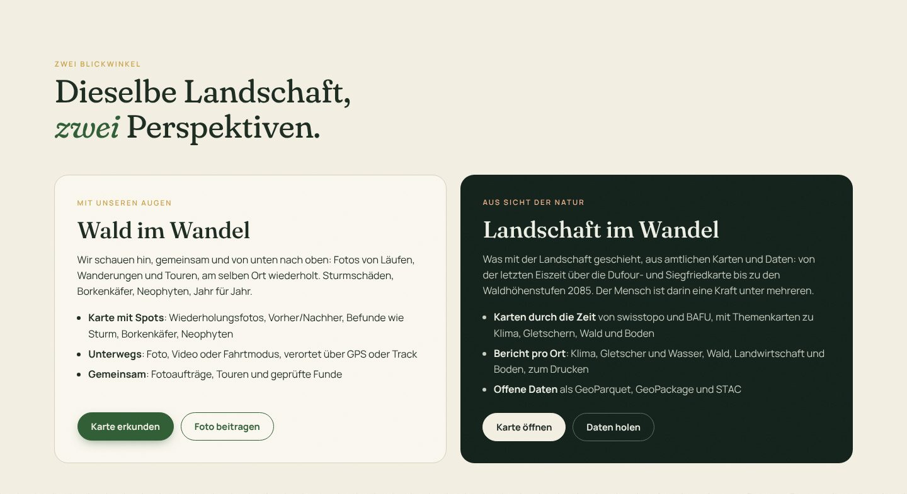
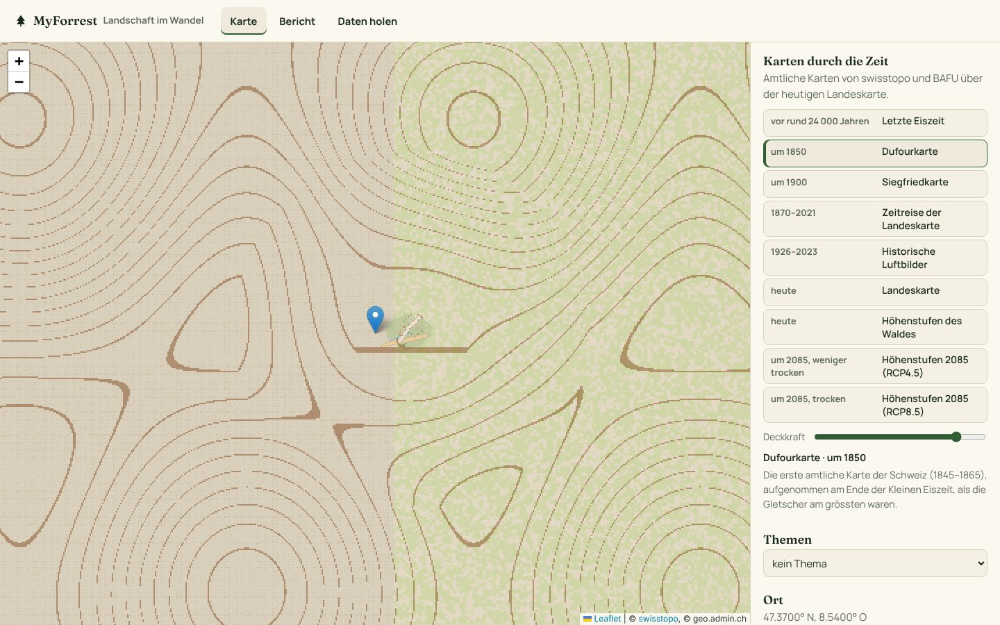
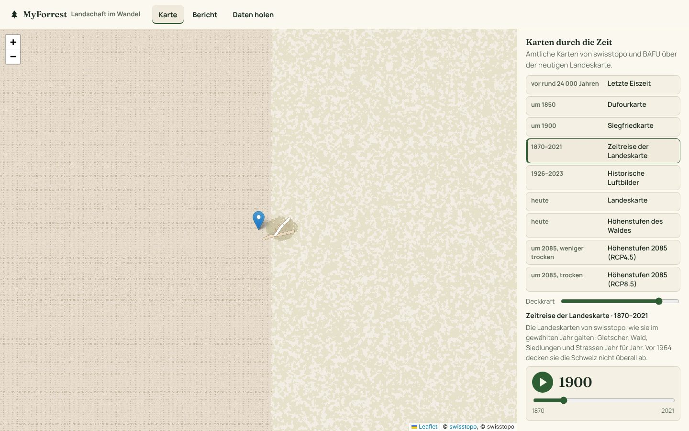
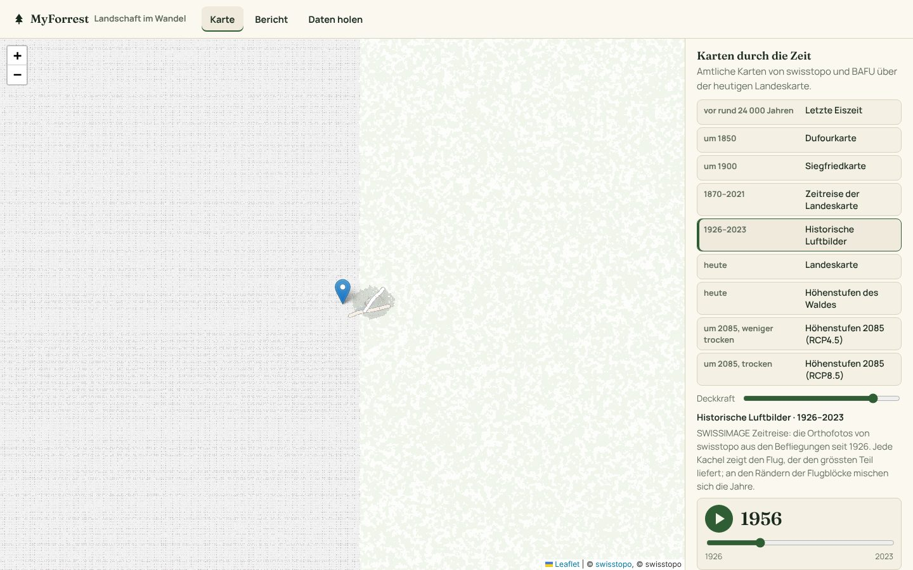
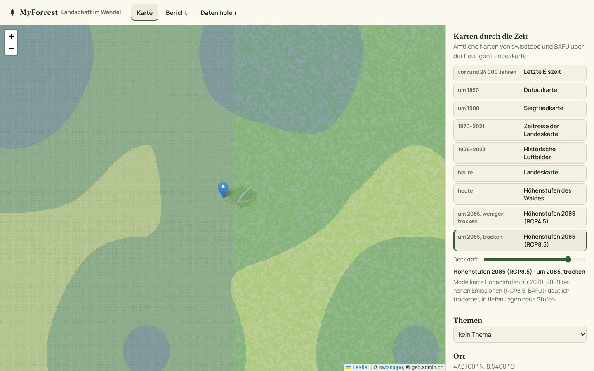
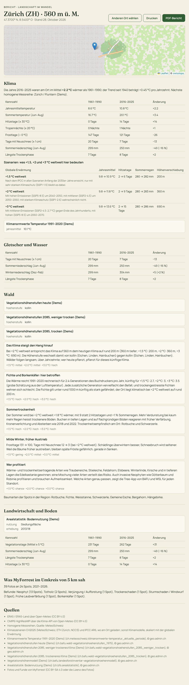
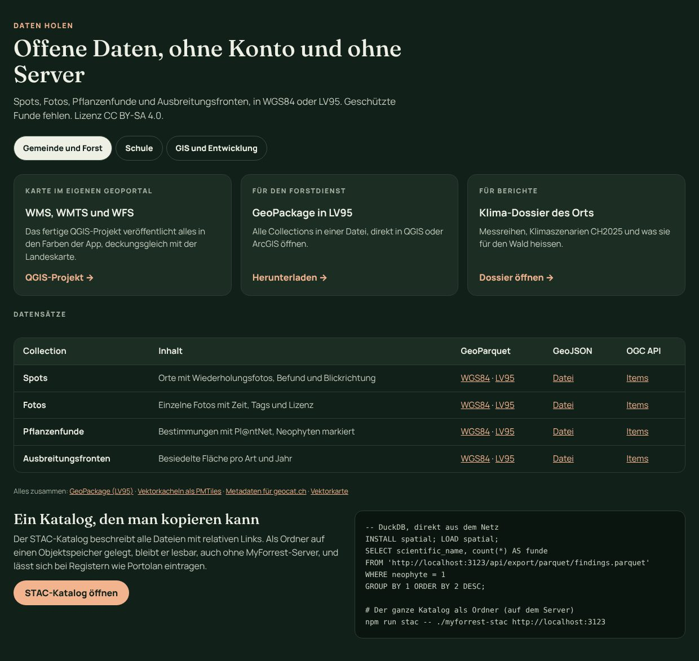

# Landschaft im Wandel – aus Sicht der Natur

MyForrest hat zwei Perspektiven auf dieselbe Landschaft:

- **Wald im Wandel, mit unseren Augen.** Menschen schauen hin, gemeinsam und von unten nach oben: Fotos von Läufen,
  Wanderungen und Touren, am selben Ort wiederholt. Das ist die Karte mit den Spots, der Hauptteil der App.
- **Landschaft im Wandel, aus Sicht der Natur.** Was mit der Landschaft selbst geschieht, über Jahrtausende und
  Jahrzehnte, aus amtlichen Karten, Messreihen und Szenarien. Der Mensch ist darin eine Kraft unter mehreren.

Die zweite Perspektive ist eine eigene Seite, `/landschaft.html`, mit drei Teilen: **Karte**, **Bericht** und
**Daten holen**. Die Startseite stellt beide Perspektiven nebeneinander, die Navigation führt mit
*Landschaft im Wandel* direkt dorthin.

> Die Screenshots zeigen den Demo-Datensatz: Statt der Karten von swisstopo und BAFU zeichnet der Demo-Server
> Platzhalter im selben Format (die Zeitreise vor 1990 in Sepia, Luftbilder vor 1990 schwarz-weiss). Im Betrieb kommen die Karten von geo.admin.ch.

## Karte

**Karten durch die Zeit.** Über der heutigen Landeskarte (grau) liegt eine amtliche Karte aus einer anderen Zeit; die
Deckkraft lässt sich einstellen, darunter stehen Erklärung und Legende:

| Zeit | Karte | Quelle (Ebene von geo.admin.ch) |
|------|-------|---------------------------------|
| vor rund 24 000 Jahren | Grösste Ausdehnung der Gletscher in der letzten Eiszeit | swisstopo, `ch.swisstopo.geologie-eiszeit-lgm-raster` |
| um 1850 | Dufourkarte (1845–1865), am Ende der Kleinen Eiszeit | swisstopo, `ch.swisstopo.hiks-dufour` |
| um 1900 | Siegfriedkarte (1870–1949) | swisstopo, `ch.swisstopo.hiks-siegfried` |
| Jahr für Jahr | Zeitreise der Landeskarte: die Karte, wie sie im gewählten Jahr galt | swisstopo, `ch.swisstopo.zeitreihen` (WMTS mit Zeit) |
| Flug für Flug | Historische Luftbilder (SWISSIMAGE Zeitreise, seit 1926) | swisstopo, `ch.swisstopo.swissimage-product` (WMTS mit Zeit) |
| heute | Landeskarte | swisstopo, `ch.swisstopo.pixelkarte-grau` |
| heute | Höhenstufen des Waldes | BAFU, `ch.bafu.wald-vegetationshoehenstufen_1975` |
| um 2085, weniger trocken | Höhenstufen 2070–2099 bei mittleren Emissionen (RCP4.5) | BAFU, `ch.bafu.wald-vegetationshoehenstufen_2085_weniger_trocken` |
| um 2085, trocken | Höhenstufen 2070–2099 bei hohen Emissionen (RCP8.5) | BAFU, `ch.bafu.wald-vegetationshoehenstufen_2085_trocken` |

Der Server sucht die Ebenen in der Ebenenliste von geo.admin.ch (WMS, einmal am Tag gelesen, wie das Panel *Ebenen*
der Karte). Fehlt eine Ebene, fehlt nur ihr Zeitpunkt.

**Zeitreise der Landeskarte.** Die Landeskarten von swisstopo, wie sie im gewählten Jahr galten, seit dem 19.
Jahrhundert: Ein Regler wählt das Jahr, ▶ spielt die Jahre ab (eines alle 1,2 Sekunden, damit die Kacheln nachkommen).
Welche Jahre es gibt, liest der Server einmal am Tag aus den WMTS-Capabilities von geo.admin.ch (`ZEITREISE_WMTS_URL`).
Vor 1964 decken die Karten die Schweiz nicht überall ab. Das Jahr steht in der Adresse (`#karte?…&jahr=1900`), so
lässt sich ein Ausschnitt mit Jahr teilen.

**Historische Luftbilder.** Die Orthofotos von swisstopo (SWISSIMAGE Zeitreise) aus den Befliegungen seit 1926, mit
demselben Regler: Er springt von Flugjahr zu Flugjahr, die Jahre kommen ebenfalls aus den WMTS-Capabilities. Die
Schweiz wurde in Flugblöcken beflogen, nicht jedes Jahr überall; jede Kachel zeigt den Flug, der den grössten Teil
liefert, an den Rändern der Blöcke mischen sich die Jahre. Der Link hält Ansicht und Jahr fest
(`#karte?…&ansicht=luftbild&jahr=1956`).

**Themen.** Eine Themenkarte lässt sich darüberlegen, nach den vier Themen des Berichts: *Klima* (Klimanormwerte der
MeteoSchweiz, Klimaszenarien), *Gletscher und Wasser* (Gletscher, Abfluss, Niedrigwasser, Trockenheit), *Wald*
(Höhenstufen heute und 2085, Waldmischungsgrad und Vegetationshöhe aus dem Landesforstinventar) und *Landwirtschaft und
Boden* (Arealstatistik, Fruchtfolgeflächen, landwirtschaftliche Zonen). Auch diese Ebenen sucht der Server nach Namen;
es erscheint, was geo.admin.ch anbietet.

**Ort.** Ein Klick in die Karte wählt den Ort; *Bericht für diesen Ort* öffnet den Bericht. Die Adresse
`landschaft.html#bericht?lat=…&lon=…` (bzw. `#karte?lat=…&lon=…`) lässt sich teilen.

## Bericht

Der Bericht fasst zusammen, was die Quellen an einem Ort sagen, mit Lage auf der Landeskarte, Höhe und Datum.
*Drucken / PDF* gibt ihn ohne Navigation aus, schwarz auf weiss.

| Abschnitt | Inhalt | Quellen |
|-----------|--------|---------|
| **Klima** | Erwärmung der letzten zehn Jahre gegenüber 1961–1990 und Trend seit 1940, Kennzahlen früher und heute (Jahres- und Sommertemperatur, Hitzetage, Tropennächte, Frosttage, Neuschnee, Sommerregen, Trockenphasen), die Szenarien +1,5, +2 und +3 °C weltweit mit Jahresmittel, Hitzetagen, Sommerregen und Höhenverschiebung, die Klimanormwerte am Ort | [Klima-Dossier](klimawandel.md): ERA5, homogene Messreihen der MeteoSchweiz, CH2025, IPCC AR6; Karten der MeteoSchweiz |
| **Gletscher und Wasser** | Gletscher in der Nähe aus den Inventaren (Eis am Ort pro Inventarjahr, Abstand zum heutigen Eis), Längenänderung der Zunge (GLAMOS), Neuschnee, Sommer- und Winterregen, Trockenphasen, Angaben der Wasserkarten | Gletscherinventare und GLAMOS (wenn auf dem Server hinterlegt), ERA5, geo.admin.ch |
| **Wald** | Höhenstufe heute und um 2085 in beiden Szenarien, Waldmischungsgrad und Vegetationshöhe, was die Szenarien für den Wald heissen (Höhenstufen, Fichte und Borkenkäfer, Trockenheit, Winter, wer profitiert), Baumarten der Spots | BAFU (Höhenstufen, Landesforstinventar), Klima-Dossier |
| **Landwirtschaft und Boden** | Bodennutzung (Arealstatistik) und weitere Bodenkarten, Vegetationstage, Sommerregen, Trockenphasen und Hitzetage früher und heute | BFS, BLW, ERA5 |
| **Was MyForrest sah** | Fotos und Spots im Umkreis von 5 km, Zeitraum, Befunde (Borkenkäfer, Sturm, Trockenschaden …) und Neophyten | Fotos und Funde von MyForrest (ohne ausgeblendete und geschützte) |
| **Quellen** | Alle verwendeten Datensätze und Kartenebenen mit Kennung | |

Die Karten fragt der Server über den Identify-Dienst von geo.admin.ch an der Stelle ab, alle Themen gleichzeitig;
Kennungen ohne Aussage (ID, Geometrie) lässt er weg. Steht in einem Thema nichts, sagt der Bericht das.

## Daten holen

Die offenen Daten von MyForrest an einem Ort, ohne Konto: drei Angebote je nach Publikum (*Gemeinde und Forst*,
*Schule*, *GIS und Entwicklung*), eine Tabelle mit allen Collections als GeoParquet (WGS84 und LV95), GeoJSON und
OGC API, das GeoPackage, die PMTiles und der STAC-Katalog mit einem Beispiel für DuckDB. Was die Formate können, steht
unter [Offene Geodaten](funktionen.md#offene-geodaten-für-gis-und-geoportale).

## Technik

- `src/routes/landschaft.js`: `GET /api/landschaft/karten` (Karten durch die Zeit und Ebenen pro Thema, aus der
  Ebenenliste von geo.admin.ch; die Jahre der Zeitreise und der Luftbilder aus den WMTS-Capabilities) und `GET /api/landschaft/bericht?lat=&lon=` (Identify pro Thema, Gletscher aus den
  Inventaren mit GLAMOS, Fotos, Befunde und Neophyten im Umkreis). Die Ebenenliste und der Identify-Dienst kommen aus
  `src/routes/layers.js` (Panel *Ebenen*).
- `public/landschaft.html`, `landschaft.js`, `landschaft.css`: Leaflet mit den Kacheln von swisstopo und den WMS von
  geo.admin.ch; der Klima-Teil des Berichts kommt aus dem Klima-Dossier (`/api/klima`).
- Tests in `test/landschaft.test.js`, mit nachgebauter Ebenenliste und Identify-Antwort.

## Quellen

- swisstopo: [Die Schweiz während des letzteiszeitlichen Maximums (LGM) 1:500 000](https://opendata.swiss/de/dataset/die-schweiz-wahrend-des-letzteiszeitlichen-maximums-lgm-1-500000)
- swisstopo: [SWISSIMAGE Zeitreise](https://www.swisstopo.admin.ch/de/orthobilder-swissimage-10-cm) (historische Orthofotos seit 1926)
- swisstopo: [Dufourkarte](https://www.swisstopo.admin.ch/) und [Siegfriedkarte](https://www.swisstopo.admin.ch/en/siegfried-map), Landeskarte
- BAFU: [Vegetationshöhenstufen 2085 (trocken und weniger trocken)](https://ckan.opendata.swiss/en/dataset/vegetationshohenstufen-modelliert-fur-2085-mit-weniger-trockener-klimazukunft)
- MeteoSchweiz: Klimanormwerte und homogene Messreihen; Klimaszenarien CH2025 (MeteoSchweiz, ETH Zürich, NCCS)
- BFS: Arealstatistik; BAFU: Landesforstinventar
- [GLAMOS – Glacier Monitoring Switzerland](https://www.glamos.ch)
- Karten und Abfragen: [geo.admin.ch](https://www.geo.admin.ch/) (WMS, Identify)
